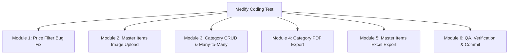

# Technical Planning & Module Breakdown: Medify Coding Test

This document provides a comprehensive requirements analysis, technical breakdown, database schema design, and step-by-step implementation plan for the Medify Coding Test within the allocated 240-minute timeframe.

---

## 📌 Requirements & Scope Overview

| No | Module / Feature | Summary |
|---|---|---|
| **1** | **Master Item Photo Upload** | Add a `foto` field and image upload functionality to Master Items CRUD, and display the image on the detail/view page. |
| **2** | **Price Min/Max Filter Bug Fix** | Fix the SQL/Eloquent query bug on min and max price filtering in the Master Items index search. |
| **3** | **Item Category CRUD (Many-to-Many)** | Implement Item Category master (name, code), search filters, single view (+ linked items table), many-to-many relationship with Master Items, CRUD form integration, and navbar navigation. |
| **4** | **Category PDF Export** | Generate and download a PDF on single category view containing category name, code, table of linked items, and a real-time print timestamp in the footer using `barryvdh/laravel-dompdf`. |
| **5** | **Master Items Excel Export** | Implement an Excel export for Master Items featuring 7 specific columns with comma-separated category names, utilizing Eloquent eager loading. |

---

## 🗂️ Module Architecture & Workflow



---

### Module 1: Fix Min & Max Price Filter (Master Items Index)
**Objective:** Resolve the query bug in `MasterItemsController@search` so that min price, max price, or both can filter records accurately and independently.

* **Root Cause Analysis:**
  In `app/Http/Controllers/MasterItemsController.php`:
  ```php
  if (!empty($hargamin)) $data_search = $data_search->where('harga_beli', '>=', $hargamin)->where('harga_beli', '<=', $hargamax);
  ```
  - If only `hargamin` is provided, `$hargamax` is `null`, resulting in a query for `<= null` (no records returned).
  - If only `hargamax` is provided, the condition is completely skipped because it is trapped inside `if (!empty($hargamin))`.
  - If an input value is `0`, PHP `empty()` evaluates to truthy falsiness and ignores the value.
* **Implementation Steps:**
  1. Separate filter checks using `$request->filled('hargamin')` and `$request->filled('hargamax')`.
  2. Ensure the resulting queries handle all variations:
     - Only Min: `WHERE harga_beli >= ?`
     - Only Max: `WHERE harga_beli <= ?`
     - Both Min & Max: `WHERE harga_beli >= ? AND harga_beli <= ?`
  3. Verify the AJAX request in `resources/views/master_items/index/js.blade.php` to ensure parameters are properly encoded.

---

### Module 2: Image Upload in Master Items CRUD
**Objective:** Add a `foto` attribute to the `master_items` table and handle image uploading and display.

* **Implementation Steps:**
  1. **Database Migration:**
     - Create migration: `add_foto_to_master_items_table`.
     - Add `foto` column (`string`, `nullable`).
  2. **Model:**
     - Add `foto` to the `$fillable` array in `app/Models/MasterItem.php`.
  3. **Form View & Upload Handling:**
     - Update the `<form>` tag in `resources/views/master_items/form/form.blade.php` with `enctype="multipart/form-data"`.
     - Add `<input type="file" name="foto" accept="image/*" class="form-control">`.
     - Display a preview or thumbnail of the existing photo when editing an item.
  4. **Controller Logic:**
     - In `MasterItemsController@formSubmit`: validate image file (jpg, jpeg, png, max size).
     - Store uploaded files to `public/uploads/items` or `storage/app/public/items`.
     - Save the file path/filename in the `foto` column.
     - On edit, remove the old file if a new file is uploaded.
  5. **Single View (Detail):**
     - Display the image using an `` tag in `resources/views/master_items/single/index.blade.php`, with a placeholder fallback if no image is present.

---

### Module 3: Category Items CRUD & Many-to-Many Relationship
**Objective:** Build a complete CRUD module for "Item Categories" and establish a Many-to-Many relationship with Master Items.

* **Database Schema Design:**
  1. **`kategoris` Table:**
     - `id` (bigint, unsigned, auto-increment, PK)
     - `kode` (string, unique)
     - `nama` (string)
     - `created_at`, `updated_at`, `deleted_at` (soft deletes)
  2. **Pivot `kategori_item` Table:**
     - `id` (bigint, unsigned, auto-increment, PK)
     - `master_item_id` (foreign key -> `master_items.id`, cascade on delete)
     - `kategori_id` (foreign key -> `kategoris.id`, cascade on delete)
* **Eloquent Relationships:**
  - In `MasterItem.php`:
    ```php
    public function kategoris()
    {
        return $this->belongsToMany(Kategori::class, 'kategori_item', 'master_item_id', 'kategori_id');
    }
    ```
  - In `Kategori.php`:
    ```php
    public function items()
    {
        return $this->belongsToMany(MasterItem::class, 'kategori_item', 'kategori_id', 'master_item_id');
    }
    ```
* **Category Controller & Views:**
  1. `KategoriController.php`:
     - `index()`: Category list page.
     - `search(Request $request)`: Filter by category `nama` and `kode`.
     - `formView($method, $id)`: Create/edit form view.
     - `formSubmit(Request $request, $method, $id)`: Store or update category record.
     - `singleView($kode)`: Single category view with eager loaded items (`$kategori->load('items')`).
     - `delete($id)`: Soft delete category.
  2. Views created inside `resources/views/kategoris/` matching the design and layout of Master Items.
* **Integrate Categories into Master Items CRUD:**
  - Add category selection (multi-select / checkboxes) to the Master Item create and edit form.
  - In `MasterItemsController@formSubmit`: synchronize selected categories:
    ```php
    $data_item->kategoris()->sync($request->kategori_ids ?? []);
    ```
  - Display associated categories on the Master Item detail page.
* **Navbar Integration:**
  - In `resources/views/layouts/app.blade.php`, add clear navigation links:
    - `Master Items` (`/master-items`)
    - `Kategori Items` (`/kategoris`)

---

### Module 4: Category Detail PDF Export
**Objective:** Generate a downloadable PDF on the single category view using `barryvdh/laravel-dompdf`.

* **PDF Document Specifications:**
  1. **Header:** Category Name (`nama`) and Category Code (`kode`).
  2. **Table of Associated Items:**
     - Columns: No, Item Code, Item Name, Type (`jenis`), Cost Price (`harga_beli`), Margin (`laba`), Selling Price (`harga_jual`), Supplier.
  3. **Footer:**
     - Real-time generation timestamp (e.g., `Printed at: 03-11-2026 12:30:00` using `Carbon::now()`).
* **Technical Implementation:**
  - Route: `GET /kategoris/pdf/{kode}`.
  - Template: Dedicated Blade file `resources/views/kategoris/pdf.blade.php` styled with clean CSS for A4 printing.
  - Controller method using `Barryvdh\DomPDF\Facade\Pdf::loadView(...)` with download/stream response.
  - Action Button: Add a **"Download PDF"** button on the single category view page.

---

### Module 5: Master Items Excel Export
**Objective:** Provide a menu/button to download Master Items data as an Excel file (`.xls`).

* **Required Columns (Exact Order):**
  1. **No**
  2. **Nama kategori (comma-separated)** *(e.g., "Medicine, Generic, Oral")*
  3. **Nama items**
  4. **Nama supplier**
  5. **Harga** *(harga_beli)*
  6. **Laba** *(laba in %)*
  7. **Harga jual** *(harga_beli + (harga_beli * laba / 100))*
* **Technical Implementation:**
  - Eager load categories to eliminate N+1 queries:
    ```php
    $items = MasterItem::with('kategoris')->orderBy('id')->get();
    ```
  - Format category names into a comma-separated string:
    ```php
    $kategoriNames = $item->kategoris->pluck('nama')->implode(', ');
    ```
  - Route: `GET /master-items/export-excel`.
  - Action Button: Add a **"Download Excel"** button in the Master Items index header.
  - Native Excel / HTML Table Stream format (`application/vnd.ms-excel; charset=utf-8`) with `Content-Disposition: attachment; filename="master-items.xls"`. This ensures 100% compatibility across test evaluation environments (`rekrutmen.sh`) without requiring external package dependencies.

---

### Module 6: Quality Assurance, Verification & Final Delivery
**Objective:** Validate all requirements end-to-end and prepare for clean repository submission.

* **Verification Checklist:**
  - [ ] Migrations run cleanly (`php artisan migrate`).
  - [ ] Image upload functions properly with validation, storage, and detail rendering.
  - [x] Price filters work accurately across all combinations (min only, max only, both, zero values).
  - [ ] Category CRUD operations (Create, Read, Update, Delete, Search) are fully functional.
  - [ ] Many-to-many relationship correctly saves and syncs between Items and Categories.
  - [ ] Category PDF downloads successfully with header, item table, and timestamped footer.
  - [ ] Master Items Excel file exports accurately with all 7 columns and comma-separated categories.
  - [ ] Navbar links for Master Items and Categories are visible and functional.
  - [ ] All database queries utilize Eloquent eager loading to prevent N+1 issues.
  - [ ] Final git commit, branch verification, and push readiness.

---

## ⏱️ Estimated Time Allocation (Total: 240 Minutes)

| Order | Module | Estimated Duration |
|---|---|---|
| 1 | Module 1: Price Filter Bug Fix | 15 mins |
| 2 | Module 2: Master Items Image Upload | 30 mins |
| 3 | Module 3: Category CRUD & Many-to-Many | 60 mins |
| 4 | Module 4: Category PDF Export | 30 mins |
| 5 | Module 5: Master Items Excel Export | 30 mins |
| 6 | Module 6: QA, Verification & Git Commit | 25 mins |
| **Total** | | **~190 mins** *(Buffer: 50 mins)* |
